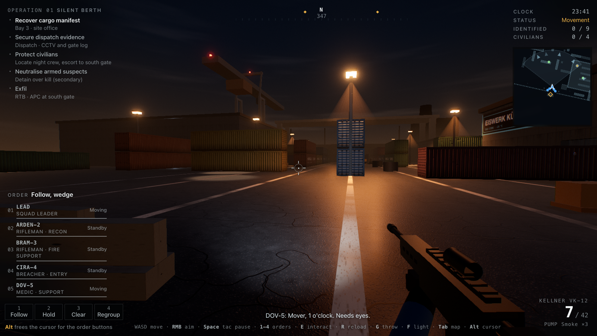
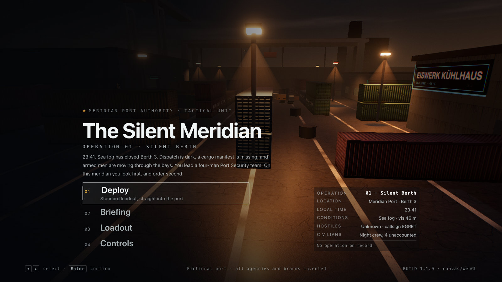
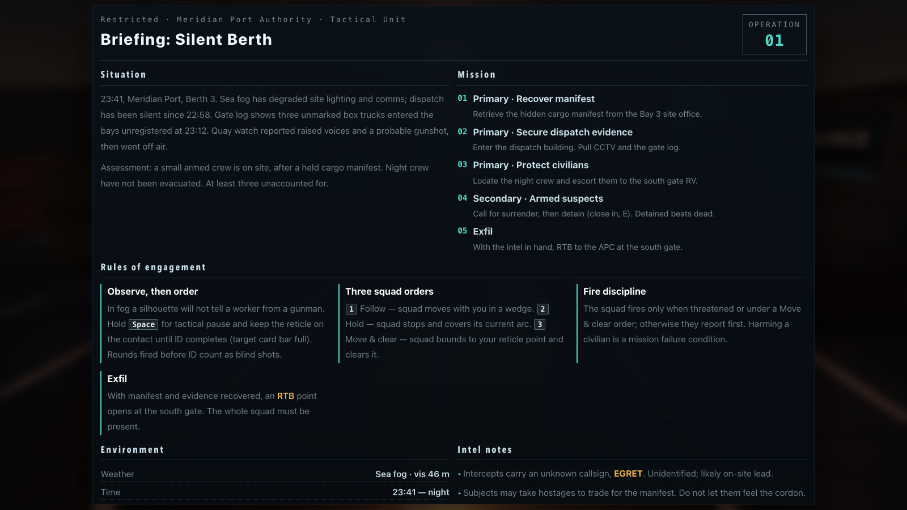
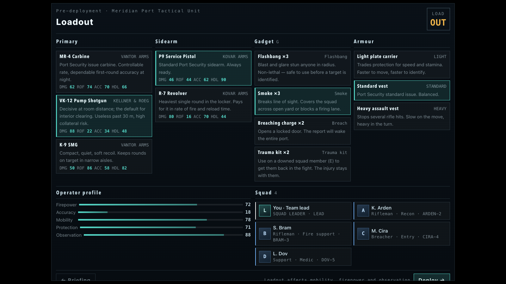
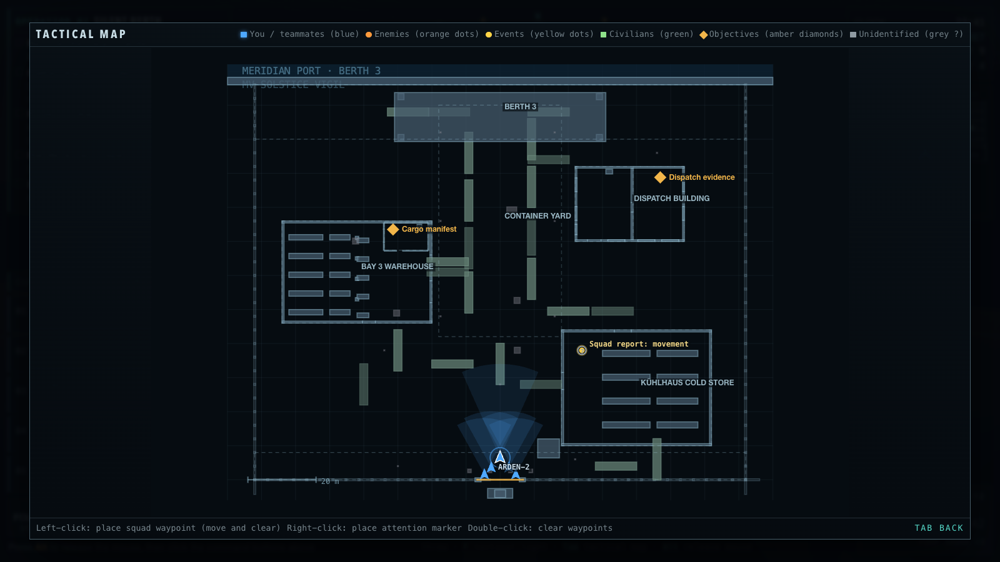
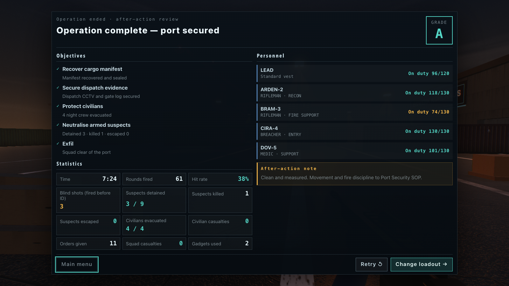

# THE SILENT MERIDIAN

> Tactical port security simulation · Operation 01: Silent Berth
> 23:41. Sea fog has closed Berth 3 at Meridian Port. You lead a four-man security team into the bays
> to deal with armed suspects, protect civilians, recover a cargo manifest and secure dispatch evidence.
> **Observe first. Order second.**

[](https://sun-sh902.github.io/Silent-Meridian/)
[](#self-checks)
[](LICENSE)
[](#one-threejs-runtime)

A pure front-end, offline-capable first-person tactical simulation: **zero runtime dependencies** (Three.js is vendored locally),
no network requests, and every texture and sound is generated procedurally with canvas / WebAudio at runtime.
One command runs 11 acceptance suites in real Chrome.

[Play online](https://sun-sh902.github.io/Silent-Meridian/) ·
[Run locally](#running-it-important) ·
[Controls](#controls) ·
[Self-checks](#self-checks)



<details>
<summary><b>More screenshots</b> (menu / briefing / loadout / tactical map / debrief)</summary>

| Main menu | Briefing |
| --- | --- |
|  |  |

| Loadout | Tactical map (Tab) |
| --- | --- |
|  |  |



All screenshots are captured automatically by `node tools/readme-shots.mjs` from the running game; they are not mock-ups.

</details>

### What it is

A **completable mission**, not a tech demo: enter the port, observe and identify, give squad orders,
detain suspects, escort civilians, recover the intel and get out — then receive a grade and an itemised debrief.

The constraints that set it apart from a practice project:

| Constraint | How it's met |
| --- | --- |
| Runs offline | No `fetch` / `Worker` / dynamic `import()` / CDN; Three.js vendored |
| No external visual assets | Textures, markings, sky and water all procedural (`src/textures.js`) |
| No external audio | WebAudio synthesises gunfire, echoes, tinnitus (`src/audio.js`) |
| Verifiable | 11 puppeteer suites in real Chrome; page errors count as failures |
| Regression-tested feel | Parameters centralised in `src/feel.js`; a baseline diff catches behaviour drift |

---

## Running it (important)

### Option A: local server (recommended; the full dev mode of `index.html`)

`index.html` and `src/*.js` are **ES modules**. Under `file://` the browser blocks the whole module graph via CORS
(`Access to script at 'file://…/src/main.js' from origin 'null' has been blocked by CORS policy`) and
**not one line of JS runs** — the page is styled but no button responds. So open it over HTTP:

```bash
git clone https://github.com/Sun-sh902/silent-meridian.git
cd silent-meridian
npm start                  # starts a local server and prints the address; zero dependencies (Node built-ins only)
```

The manual equivalent (no Node needed):

```bash
python3 -m http.server 8123
```

> On macOS you can also double-click `start.command`; it changes to its own folder and starts the server.

Then visit:

```
http://localhost:8123/
```

(Change the port with `npm start -- --port 9000`, or in the command; the address follows.)

### Option B: no server, just double-click

Either of these files runs from `file://` without a local server:

| File | Notes |
| --- | --- |
| `dist/silent-meridian.html` | Single-file build: JS / CSS / textures all inlined, one file |
| `index.html` | Detects `file://` and loads `dist/silent-meridian.js` instead (a **classic script**, not subject to module CORS) |

> Option B needs `dist/` to exist and **not be stale**. If you've changed `src/` or deleted `dist/`, run
> `node build.mjs` first. If `dist/silent-meridian.js` is missing, the page shows that exact command.
>
> ⚠️ **After changing `src/`, rebuild before testing option B.** Stale and fresh bundles carry the same version and
> look identical; `npm test` runs `tools/check-dist.mjs` first to catch it by content hash (see "Self-checks").

> This repository **commits `dist/`** (about 1.4 MB) so a fresh clone is playable by double-click without installing or building.
> The cost: changes to `src/` must be rebuilt and committed, or the committed bundle goes stale —
> `check-dist`, the first item in `npm test`, exists for exactly that (see "Self-checks").

### Rebuilding

```bash
node build.mjs
# → dist/silent-meridian.js   (classic script, loadable from file://; header carries vX.Y.Z + content hash)
# → dist/silent-meridian.html (single file)
# → dist/build-stamp.json     (this build's input fingerprint, used by check-dist to detect staleness)
```

### Why two loading paths

| Opened as | Loads | Runs |
| --- | --- | --- |
| `http://localhost:8123/` | `src/main.js` (`type="module"` + import map) | ✅ |
| `file:///…/index.html` | the bootstrap sees `file:` and loads `dist/silent-meridian.js` (IIFE classic script) | ✅ |
| `file:///…/index.html` (no dist) | load fails → the page shows the command + the debug panel goes red | ⚠️ a clear message, never a silent dead page |

The code has no `fetch` / `Worker` / dynamic `import()` / network assets and every texture is generated on canvas,
so the classic-script bundle runs completely under `file://`.

---

## Debug panel (did the script actually run?)

Press **`D`** to open it (main menu / briefing / loadout / debrief / **pause menu**); **in mission `D` belongs to the game (strafe right)**, so use **`~`** (backquote) there.
The panel always shows:

* **Bootstrap ran** — when the bootstrap executed (it's an inline classic script, so it always runs)
* **Loaded via** — `http:` / `file:` and the loader actually used
* **Main script** — ✓ loaded / ✗ load failed
* **Action handler** — ✓ registered (lists every action) / ✗ not registered (the game script isn't running)
* **Buttons** — number of `[data-action]` elements in the DOM
* **Pointer lock** — while locked, press `Alt` before clicking buttons
* **Recent clicks** — time / tag / action name, to confirm a click really arrived

---

## Controls

| Key | Action |
| --- | --- |
| `W` `A` `S` `D` | Move |
| `Shift` / `Ctrl` | Sprint / sneak |
| Mouse | Look (click the view to lock the pointer) |
| Right mouse | Aim down sights (faster identification, tighter spread) |
| Left mouse | Fire |
| `R` | Reload |
| `G` | Throw gadget (hold to charge) |
| `F` | Weapon light (see further, but easier to spot) |
| `E` | Interact: take item / escort civilian / detain suspect / treat squad member |
| Space (hold) | Tactical pause: time slows to 10% for observing and ordering |
| `1` | Follow |
| `2` | Hold |
| `3` | Move & clear (advance to the reticle point) |
| `4` | Regroup |
| `Tab` | Tactical map (left click: squad waypoint / right click: attention marker) |
| `Alt` | Free the cursor (cursor mode): click HUD order buttons; click the view to resume |
| `Esc` | Pause menu |
| `M` | Mute |

> The UI re-flows with window size and browser zoom without overlapping. `D` opens the debug panel with viewport info
> (menu / briefing / loadout / debrief / pause only; **in mission `D` strafes right** — use `~`).
> The debug panel's "Build stamp" row shows the bundle version and content hash and turns red on a mismatch with the page.

---

## Feel parameter hub and tuning panel (batch 1)

Every handling number lives in **`src/feel.js`**. Logic reads the object every frame and never caches it at construction — change a number and it applies immediately.

| Group | Contents |
| --- | --- |
| `move` | walk/sprint/crouch/ADS speeds, stamina, accel/decel/glide time, diagonal normalisation, turn damping |
| `jump` | jump parameters (**all disabled** this round, all zero; an `onLanding` hook is reserved) |
| `camera` | default/sprint/ADS FOV, sensitivity and ADS multiplier, head bob amplitude and **toggle**, camera roll |
| `weapon` | recoil kick, recovery rate, horizontal jitter, recoil→aim conversion, fixed pattern toggle |
| `spread` | base/move/sprint/burst spread, recovery rate, recoil and suppression contributions |
| `feedback` | hitmarker time, hit stop, damage numbers, screen shake strength and decay, muzzle flash time, shell eject speed |
| `reload` | weapon switch time, ADS in/out rate, reload time scale, reload cancelling |
| `viewmodel` | first-person weapon bob/drag/push-back (inertia carrier; by design the reticle stays 1:1 with no lag) |

> `TUNING` in `data.js` (AI/identification parameters) is **deliberately left as is** and is not part of this file.

### Tuning panel

| Key | Action |
| --- | --- |
| `P` | Full panel: bottom drawer (keeps roughly the top third of the frame), **frees the pointer, time stays at 100%, WASD still moves** |
| `O` | Read-only overlay: **keeps the pointer**, shows four live curves and values |
| `[` `]` | In overlay mode, decrease / increase the selected parameter |
| `,` `.` | In overlay mode, select the previous / next parameter |

The panel offers **Export JSON** + **Copy**, **3 preset slots** (slot A is pinned to "original (pre-change)" for A/B comparison),
**Freeze hostile AI**, **Invulnerable**, **Head bob toggle** and **Reset curves**.
Parameters badged `not wired` belong to batches 2/3; dragging them currently changes nothing (so as not to mislead).

The four curves come from the `telemetry` ring buffers in `feel.js` (preallocated, zero GC): speed, acceleration, recoil, spread.

### Feel regression baseline (proves batch 1 changed no behaviour)

```bash
node tools/feel-baseline.mjs compare tools/feel-baseline.json
```

Drives `game.advance()` at a **fixed 1/60 s step** (`?test=1` freezes rAF), removing frame-rate jitter and rendering differences,
so results are bit-reproducible. Compared: steady speed and FOV for four stances, start/release ramps, camera roll and head bob,
first/last burst spread, per-shot recoil accumulation and recovery, reload/switch/ADS timings, shake envelope, muzzle flash duration.

> Run the baseline on the same machine; GPU/browser versions don't matter (it only runs the simulation, not rendering).

### Fixed: double fire rate and halved blind time

`player.update()` called `updateCommon(dt)` (which already does `fireCd -= dt`) and then decremented it again,
so `fireCd` dropped by 2×dt per frame:

* the MR-4, rated 640 rpm, fired every 3 frames (≈1200 rpm) — **fixed**, now every 6 frames;
* the same bug decremented `blind` twice, halving flashbang blind time (2.5–7 s became 1.25–3.5 s) — **fixed**.

After the fix the baseline uses the new value: `spread.shots` went from 30 to **15** (90 frames at a fixed 1/60 s step).
The theoretical count is 16 (1.5 s × 640 rpm ÷ 60); 15 is measured because the fire interval is quantised to whole frames:
640 rpm ⇒ 5.625 frames, rounded up to 6 ⇒ effective 600 rpm.
That's the inherent quantisation of per-frame decrement and it **varies with refresh rate** (617 rpm at 144 Hz).
Matching the rated rate exactly would mean carrying the remainder (`this.fireCd += rate` instead of `this.fireCd = rate`);
that's a separate issue and hasn't been changed.

> After changing `feel.js` or anything that affects feel, re-capture the baseline:
> `node tools/feel-baseline.mjs capture tools/feel-baseline.json`

## Responsive layout and zoom

* **Type**: always the `--fs-*` tokens, each written as `max(Nrem, 12px)` — **never below 12px**.
* **Sizes**: widths/heights use `clamp()` / `rem` / `vmin`, spacing uses `--pad-*`; the root size `clamp(15px,…,18px)` scales gently with the viewport.
* **Layout**: the HUD is a `grid` (three rows × three columns); every panel takes part in layout and re-flows at breakpoints.
  Only the full-screen effect layers and the reticle cluster stay absolutely positioned — the latter must be locked to the viewport centre to match the aim ray.
* **Breakpoints**: `≥1920` / `≤1439` / `≤1023` / `≤767` / `≤480`, plus **short-window compression tiers** at `≤760px`, `≤620px`, `≤520px`, `≤440px`.
  Narrow screens hide secondary elements (minimap, radio, hint bar, compass) rather than squeezing text.
* **Canvas**: `ResizeObserver` watches the container and `matchMedia('(resolution: Ndppx)')` watches DPR;
  the backing store always equals `CSS size × devicePixelRatio` (capped at 2), so zooming never blurs or distorts.
* **No overflow**: `html/body/#app/#hud` are all `overflow:hidden`; no horizontal scrollbar.

### Responsive acceptance test

```bash
node tools/responsive-test.mjs
```

Four sweeps plus a renderer check, **39 audits** in total:

* 0: under `prefers-reduced-motion`, post grain/aberration are off and the light-shaft / mote clock is frozen

* A: 8 widths (1920 / 1440 / 1280 / 1024 / 900 / 768 / 600 / 480)
* B: 5 browser zoom levels (50% / 75% / 100% / 125% / 150%, physical window 1440×900)
* C: 4 screens (title / briefing / loadout / controls) × 5 widths
* D: debrief panel × 5 widths

Each asserts: no horizontal scrollbar, key panels never overlap, text never overflows or clips, type ≥ 12px,
and the canvas backing store equals `CSS size × DPR` with an unchanged aspect ratio.

> **Why Alt?** In mission the browser holds pointer lock, so every click goes to the 3D view
> and HUD buttons never receive it. `Alt` frees the pointer so the order buttons can be clicked;
> time slows to 30% meanwhile. Click anywhere in the view to return to mouse look.
> The keyboard shortcuts `1` `2` `3` `4` work in every state.

---

## Core mechanics

### Friendly fire and identification

* **Friendly fire is off**: the player and the four squad members are all blue team; rounds **pass straight through** friendlies without damage
  (with a second backstop at the damage entry point). Rounds that pass through a squad mate still hit the hostile behind.
* **Civilians can still be hit** — that's a mission failure condition; the rules of engagement are not softened.
* With the reticle on a squad mate the target card shows their **callsign and role**, not `UNKNOWN CONTACT`.

### Tactical map colours

| Marker | Meaning |
| --- | --- |
| 🔵 blue arrow | player and squad (the player has a white outline) |
| 🟠 orange dot | identified hostile (hollow ring when surrendered/detained) |
| 🟡 yellow dot | event: gunfire / alarm / explosion / intel recovered / casualty / civilian located |
| 🟢 green square | civilian |
| 🔶 amber diamond | objective |
| ⚪ grey `?` | unidentified contact (keeps the core "observe before ordering" mechanic) |

Event dots fade after about 2 minutes; those from the last 15 seconds show a text label.

### Coordinate conventions of the two maps (fixed)

| | Minimap `#minimap` | Tactical map `#tacmap-canvas` |
| --- | --- | --- |
| Mode | **heading up** (rotates with the player) | **north up, fixed** (world-fixed) |
| Transform | translate(−player) → rotate **+yaw** about the player → scale k → translate to canvas centre | translate(−bounds) → uniform scale → centre |
| Rotation centre | **the player's own position** (not the canvas origin) | no rotation |
| Angles | radians throughout; recomputed from absolute `p.yaw` every frame, no accumulator | same |

> ⚠️ **Yaw sign convention in this project**: `player.look()` does `yaw -= dx * sens`,
> so **turning the mouse right decreases yaw**, turning left increases it. That's the opposite of "yaw increases = turn right";
> keep it in mind when touching map heading code.

### `window.__mapDebug`

```js
__mapDebug.mode              // 'minimap=player-up(rotating) / tacmap=north-up(fixed)'
__mapDebug.player            // { x, y, yaw }   ← y is world z
__mapDebug.yawRad / yawDeg   // current heading
__mapDebug.buildings         // [{ name, x, y }]
__mapDebug.worldToMap(x, z)  // world → minimap pixels (also accepts {x,z}; rotated, heading up)
__mapDebug.worldToMapTac(x, z) // world → tactical map pixels (north up)
__mapDebug.mapToWorld(mx, my)  // minimap pixels → world
__mapDebug.labels / labelsMini // { stats:{total,drawn,rejected,offscreen}, items:[…] }
```

### Map label rules

* Text is **always drawn horizontally** and never rotates; the anchor rotates, not the glyphs.
* Font sizes are fixed design pixels; since `render()` already `setTransform(dpr,…)`, they don't shrink on HiDPI or stretch with map scale.
* **Collision avoidance**: candidates are sorted by priority + distance to the player and placed one by one; overlapping ones are hidden (see `stats.rejected`).
* Anything outside the visible range is skipped; large and near zones win.
* Every label gets a dark translucent backing so it reads on light and dark backgrounds.

### Observe, then order

In fog you can't tell a civilian from a gunman by silhouette. Keep the reticle on a target and a target card with an
identification bar appears at screen centre:

* `UNKNOWN CONTACT` — only that something is there;
* `PERSON · UNIDENTIFIED` — spotted, not confirmed;
* `ARMED SUSPECT` / `CIVILIAN · NON-COMBATANT` — identification complete.

Firing before identification completes counts as a blind shot and costs grade; harming a civilian fails the mission outright.
Hold Space for tactical pause and you can complete identification and give orders without risk.

### Three squad orders

* Follow — the four move with the lead in a wedge, routing around obstacles.
* Hold — the squad stops and covers its current arc, taken from the lead's view direction when the order is given.
* Move & clear — the squad splits into two elements and bounds to the waypoint (bounding overwatch):
  one element moves while the other covers.

The squad keeps fire discipline by default: it fires only under a Move & clear order or when fired upon; otherwise it reports.
Give an order while looking directly at one squad member and it goes to that member only.

### Tactical map (Tab)

A top-down plan of the port showing the squad, identified contacts, objectives and last-seen positions.
Left click places a waypoint (= Move & clear), right click places an attention marker, double-click clears.

---

## Objectives

| Objective | Notes |
| --- | --- |
| Recover cargo manifest | The document in the Bay 3 site office |
| Secure dispatch evidence | CCTV and gate log in the dispatch building |
| Protect civilians | Find the night crew and escort them (`E`) to the south gate RV |
| Armed suspects (secondary) | Detain over kill: call for surrender, close in, `E` to detain |
| Exfil | Opens at the south gate APC once the three primary objectives are complete |

---

## Project layout

```
index.html            page skeleton and all screen DOM
styles/ui.css         UI styles (HUD / briefing / loadout / map / debrief)
src/main.js           bootstrap and debug parameters
src/game.js           mission orchestration: orders, identification, objectives, main loop
src/world.js          original port layout, lighting, sea fog, environment map
src/actors.js         character models, squad / suspect / civilian AI
src/player.js         team lead controller
src/combat.js         ballistics, hits, projectiles, effects
src/nav.js            navigation grid and A* pathfinding
src/geom.js           maths, spatial grid, line of sight, collision
src/viewmodel.js      first-person weapon and pose
src/hud.js            heads-up display
src/tacmap.js         tactical map
src/screens.js        main menu / briefing / loadout / debrief
src/textures.js       procedural textures and invented markings
src/audio.js          procedural WebAudio sound
src/feel.js           feel parameter hub (single source of truth) + live telemetry ring buffers
src/tuning.js         tuning panel (P / O)
src/canvasfit.js      canvas size and DPR fitting (ResizeObserver + matchMedia)
src/maplabel.js       map label avoidance (object pool + width cache)
vendor/three.module.js  Three.js runtime (vendored, works offline)
vendor/three.core.js    Three.js runtime core (imported by the line above)
tools/                11 puppeteer acceptance suites + perf/feel baselines + screenshot scripts
docs/shots/           README screenshots (generated by tools/readme-shots.mjs)
dist/                 build output (committed: double-click to play)
```

### Tech stack

No framework, no toolchain beyond the bundler, no CI service dependency:

| Layer | What | Notes |
| --- | --- | --- |
| Rendering | Three.js `0.180.0` (vendored) | the only runtime dependency; files in `src/` import bare `three` |
| UI | plain DOM + one `styles/ui.css` | no framework, no virtual DOM; HUD updates optimised for per-frame cost |
| Logic | native ES modules | runs straight in the browser, no compile step |
| Assets | none | textures/sounds all procedural; the repo has no art asset files |
| Build | esbuild (devDependency only) | only to produce the `file://`-capable `dist/*` |
| Tests | puppeteer-core + local Chrome | 11 suites; page errors, `console.error` and failed requests all FAIL |

### One Three.js runtime

Files in `src/` use the bare specifier `import ... from 'three'`, which resolves two ways:

| Path | Resolves to | Used for |
| --- | --- | --- |
| Dev (http) | the import map in `index.html` → `vendor/three.module.js` | browsing via a local server |
| Bundle (file://) | esbuild `--alias:three=./vendor/three.module.js` | `dist/*` |

`build.mjs` sets the alias explicitly, pinning the bundle to `vendor/` too, so **the two copies can't diverge**.
`three` in `package.json` is pinned to exactly `0.180.0` and is only there for editor/tooling type resolution; it isn't bundled.

## Rendering

Everything is procedural and offline; the look comes from physics first, effects last:

| Layer | What it does | Where |
| --- | --- | --- |
| Albedo and materials | Dielectric asphalt/water/paint (metalness 0), physically plausible albedos, a wet-asphalt clearcoat driven by a world-space wetness mask, corrugated containers with worn door ends | `src/world.js`, `src/textures.js` |
| Light | One sky gradient feeds the environment map, the visible sky and the fog's far colour; hemisphere split, upward sodium bounce, wide-penumbra lamp spotlights with inverse-square falloff, low-decay far fills, a dim moon key; baked sky visibility indoors | `src/world.js` |
| Atmosphere | Fog density fixed for gameplay, colour graded by distance, thinning with height so tall structures rise out of the sea-fog layer; soft light shafts and forward-scattering motes | `src/world.js` |
| Title screen | The menu sits over the live port: a slow camera loop through the fog (one composed shot under reduced motion). Deploy adopts that world and glides the camera into the player's eyes — no load, no cut. Arrow keys move through the menu; the operation card shows this browser's last result | `src/attract.js`, `src/game.js` |
| First-person weapon | Lit by a camera-space mirror of the world lights (lamps, sky, environment), so it warms under a lamp and darkens in shadow | `src/viewmodel.js` |
| Post | Half-float scene target, wide low-intensity bloom, one composite pass (ACES, a single grade curve, mild vignette, dither, grain, chromatic aberration, FXAA-style edge AA). Off with `?nopost` | `src/post.js` |

Exposure (`renderer.toneMappingExposure = 1.0`) is the only global brightness control. Every time-varying visual effect
runs on simulation time (deterministic under `?test=1`) and stops under `prefers-reduced-motion`.

`node tools/render-time.mjs [--ab]` measures render cost at the five fixed poses (`--ab` alternates post on/off inside one
page, which cancels machine-load drift).

## Debug parameters

Append query parameters to the address for verification:

`?deploy=1` start in mission · `&pos=x,z` spawn position · `&yaw=radians` heading
`&alarm=1` raise the alarm at once · `&dummy=8` place static targets straight ahead
`&tacmap=1` open the tactical map · `&screen=briefing|loadout` open a given screen
`&debrief=1` show a sample debrief · `&novm=1` hide the first-person weapon
`&nopost` disable post-processing (renders straight to the canvas, CSS grade overlays back on)
`&noattract` plain title backdrop instead of the live port (QA entry points with `deploy`/`test` skip it automatically)

## Self-checks

### Every acceptance suite in one command

```bash
npm test            # = node tools/run-all.mjs, 11 suites, per-suite summary and exit code
```

Suites (`npm run test:<name>` runs one):

| Suite | Purpose |
| --- | --- |
| `test:dist` | dist/ staleness check (content hashes, no browser) |
| `test:click` | full UI click paths under all three loading paths |
| `test:fixes` | pre-mission silence / target card / friendly fire / map colours |
| `test:p0` | reproduction and regression of the P0 defects (including fixed-step driving via `?deploy=1&test=1`) |
| `test:p1` | fire rate and blind time, diagonal speed, AI cover loop, frame-rate independence, mission timers, ID time base, AI bursts |
| `test:map` | minimap / tactical map coordinates and markers |
| `test:tuning` | tuning panel: sliders reconciled against `FEEL_SCHEMA`, export/copy paths |
| `test:responsive` | 8 widths × 5 zoom levels × per-screen layout audits |
| `test:audio` | 20-flashbang stress test against a control group |
| `test:feel` | bit-exact feel baseline comparison |
| `test:selftest` | injects an uncaught error to prove the harness really goes red |

### dist/ staleness check (no browser, takes seconds)

```bash
node tools/check-dist.mjs
```

Under `file://`, `index.html` loads exactly `dist/silent-meridian.js`.
**If `src/` changes and the rebuild is forgotten, double-click players keep running the old bundle, which carries the same version as a fresh one and looks no different from outside.**
This script compares the input content hashes (`src/**/*.js`, `index.html`, `styles/ui.css`, recorded in `dist/build-stamp.json`)
with the current files one by one; any file changed after the build FAILs and is listed:

```
[FAIL] dist is not stale (src / index.html / ui.css unchanged since the build)
       — changed: src/game.js — run: node build.mjs
```

Content hashes rather than mtime, so `git clone` / checkout order doesn't matter.
At runtime there's a second layer: the debug panel's "Build stamp" shows the version and hash embedded in the bundle
and turns red on a version mismatch with the page (stale content at the same version can't be detected at runtime; this script covers that).

### Performance and resource probe (a comparable quantitative baseline)

```bash
npm run perf                              # print current metrics
npm run perf:save                         # save as tools/perf-baseline.json
npm run perf:diff                         # compare with the baseline, non-zero exit on clear regressions
```

Reports per-frame DOM mutations, layout reads and logic time, plus GPU resource growth across repeated deploys.
It is **not** a pass/fail test but a ruler — to prove an optimisation really works rather than going by feel.

Each metric knows which direction is better: FBO deletions higher is better, everything else lower;
logic time is noisy under swiftshader (few sampled frames), so it's reference only and never a failure.
Deploy growth uses the delta between consecutive deploys to measure steady-state leaks, so the first deploy's one-off initialisation isn't counted as a leak.

### Logic throughput benchmark (low variance, for A/B)

```bash
npm run bench                             # print results
npm run bench:save                        # save as tools/perf-bench.json
npm run bench:diff                        # compare with the baseline, non-zero exit on clear regressions
```

`perf-probe` measures steady-state cost; `perf-bench` measures pure logic throughput + draw calls.
The latter freezes rAF with `?test=1` and drives `advance()` manually at a fixed step, so it's almost immune to software rasterisation
noise — the key to a credible A/B comparison. Each scenario runs several rounds.

> Two traps (handled and commented in the tool):
> 1. `Game.loop()` calls `renderer.render()` **twice** per frame (main scene + the viewmodel's private scene),
>    and `info.autoReset` is true — the second call zeroes the counters, so reading `info.render.calls` directly
>    gives the weapon's dozen draw calls, not the level. Wrap render and sample only after the main-scene call.
> 2. The logic benchmark teleports actors to 999 (far beyond `far=420`); measuring rendering right after
>    frustum-culls the whole scene and gives empty-scene numbers. Redeploy first, then sweep the views.

> Measured results of the P2/P3 round (same machine, HEAD before/after, 900 fixed steps):
>
> Method: baseline and optimised **interleaved, two runs each**, best of each, to cancel machine drift.
> Before hardening, the same code rerun across processes jittered about ±15%; with "one warm-up round + minimum of 9 rounds" it converges to about ±5%.
>
> | Scenario | Before | After | Change |
> | --- | --- | --- | --- |
> | logic idle-follow | 118.3 ms | **32.1 ms** | **-72.9%** |
> | logic clear-order | 121.5 ms | **35.1 ms** | **-71.1%** |
> | logic engage-9 (9-way firefight) | 141.3 ms | **60.8 ms** | **-57.0%** |
> | logic squad-firing | 118.0 ms | **42.1 ms** | **-64.3%** |
> | **of which HUD alone** | **100.7 ms** | **23.4 ms** | **-76.8%** |
> | main-scene draw calls (median) | 119 | **93** | -21.8% |
> | main-scene draw calls (peak) | 275 | **244** | -11.3% |
> | geometries | 492 | **452** | -8.1% |
> | triangles (median) | 11992 | 14558 | +21.4% (traded against draw calls, reference only) |
> | shader programs | 16 | 32 | +100% (post pass + patched fog chunks) |
> | textures | 46 | 64 | +39% (wetness, normal, container, paint maps) |
> | DOM mutations per frame (perf-probe) | 27.3 | **2.6** | -90% |
> | layout reads per frame (perf-probe) | 55.2 | **3** | -95% |
> | net textures per redeploy | +8 | **0** | constant 37 across 10 deploys |
> | net geometries per redeploy | +24.6 | **0** | fluctuates 398–423, no upward trend |
>
> About 8–10 points of that came from **removing rain**: 5200 rain-streak particles and their custom shader,
> a whole full-screen CSS rain compositing layer, and lightning ambient light are all gone.
>
> **Attribution**: before optimisation `hud-update-only` (100.7 ms) was about **85%** of `idle-follow` (118.3 ms) —
> per-frame HUD DOM/layout cost was the single biggest logic cost. With that down to 21.2 ms,
> the remaining ~7 ms is the actual game logic.
>
> **Visual-overhaul round.** The numbers above are re-measured on the current tree (the overhaul added a
> bloom/composite pass, a patched fog shader, `MeshPhysicalMaterial` wet ground and a viewmodel that mirrors
> the world lights). Logic cost did not move — this is a rendering change. What it did cost: shader programs
> doubled (16 → 32) and textures grew 39% (46 → 64), both from the new passes and material maps; the full
> suite went from 191 s to 282 s, almost entirely post-processing under swiftshader, which is not a logic
> regression and should not be profiled as one.

> **The triangle increase is accepted on purpose**: merging 46 puddles into one mesh loses per-object frustum culling,
> so up to 644 triangles are submitted every frame; in exchange up to 46 transparent draw calls become 1.
> Draw calls are scarce (each carries state validation and uniform uploads),
> while a few hundred triangles per frame are negligible on any GPU.

### Click path self-check

Runs every UI button's click path in real Chrome (not a preview pane), across three loading paths:

* `http://localhost` server mode
* `file://` opening `dist/silent-meridian.html` (single file)
* `file://` opening `index.html` (falls back to the classic script automatically)

```bash
node build.mjs && node tools/click-test.mjs
```

Checks menu navigation, loadout picks, deploy, HUD order buttons, tactical map waypoints, pause/resume/abort and
debug panel contents, and uses `elementFromPoint` to verify every button really receives its own click (an occluded button FAILs).

> The Chrome executable is not hard-coded: `CHROME_PATH` first, otherwise common paths on macOS / Linux / Windows
> are probed in turn; if none is found it exits with code 2 and prints the paths tried (no stack trace).
> Uncaught page errors, `console.error` and failed resource loads all count as failures and affect the exit code —
> `tools/selftest-red.mjs` injects an uncaught error to prove the chain really turns tests red.

### Audio / flashbang stress test

```bash
node tools/audio-stress.mjs
```

Fires 20 flashbangs back to back and compares against a "throw nothing" control group, checking:

* **exactly 20** detonations (guards against a "re-detonate every frame" regression)
* main-thread logic per frame (excluding render) averages < 16 ms, peaks < 50 ms
* `AudioContext` count is always 1; audio nodes fall back after use
* projectiles / DOM log / whiteout layer all reclaimed; no uncaught errors

### README screenshots

```bash
node tools/readme-shots.mjs        # → docs/shots/*.png (drives the real UI with local Chrome)
```

Drives main menu → briefing → loadout → deploy → tactical map → debrief along the user path and captures each screen;
every step asserts the target screen really appeared and exits non-zero otherwise (so a blank screenshot never counts as success).
It is **not part of `npm test`**: it's a manual workflow and shouldn't rewrite repo files on every regression run.

### Fixed-pose shots and value statistics

```bash
node tools/shots-fixed.mjs [--tag name] [--repeat 3]   # → /tmp/shots/<tag>/*.png + stats.json
node tools/shots-fixed.mjs --pair /tmp/shots/before /tmp/shots/after
```

Five named camera poses (gate-approach / yard-center / yard-lamp / container-row / dock-edge) with fixed position, heading, FOV,
in-game clock and step count, rendered through `?test=1` + `game.advance()` + `game.renderFrame()`.
Prints per-image mean luminance, crushed-black / midtone / highlight-clipping ratios and mean saturation,
for both the player-visible frame and the raw canvas. `--repeat` verifies that shots are pixel-identical.

---

## Audio implementation constraints (why it no longer stalls or clicks)

| Constraint | Where |
| --- | --- |
| Exactly one `AudioContext` (module-level singleton, a second is never created) | `src/audio.js` `acquireContext()` |
| Each voice `disconnect()`s and drops its references in `onended` after `stop()` | `src/audio.js` `_v()` |
| At most 40 simultaneous voices; excess is dropped to prevent avalanches | `src/audio.js` `_budget()` |
| Minimum interval per named sound (flashbang 150 ms) so pile-ups can't howl | `src/audio.js` `_gate()` |
| White-noise buffer built once, async in 16384-sample chunks | `src/audio.js` `_buildNoiseBuffer()` |
| Every gain change ramps ≥5 ms, never an instant assignment (mute included) | `src/audio.js` `_env()` / `setMuted()` |
| `DynamicsCompressor` limiter at the end of the chain + output gain 0.8 | `src/audio.js` `init()` |
| Tinnitus tone 2.2 kHz + softening low-pass + level 0.028 (not piercing on headphones) | `src/audio.js` `flashbang()` |
| Blind whiteout uses only a CSS opacity transition, zero per-pixel work | `src/hud.js` `flash()` |

---

## Open source and deployment

* **License**: [MIT](LICENSE) — use, modify, distribute and sell freely; keep the copyright notice.
* **Play online**: GitHub Pages serves the repository root as the site (`index.html` is the entry point,
  `src/` loads as ES modules, no build step).
* **Purely static**: the site has no backend at all and can be dropped onto any static host (Vercel / Netlify / Cloudflare
  Pages / object storage); the single-file `dist/silent-meridian.html` is especially easy to distribute.
* **To change the code**: `npm install` → start the local server → edit `src/` → `npm test` → `node build.mjs`.
  If you change behaviour, add an assertion; the suites in `tools/` treat page errors as failures too.

### Contributing and feedback

Issues and PRs are welcome. Before submitting, make sure `npm test` passes 11/11, and if `src/` changed,
rerun `node build.mjs` (otherwise `check-dist` goes red).

---

The port, agencies, brands, ship names and people in this work are all fictional and unrelated to any real company, organisation or person.
